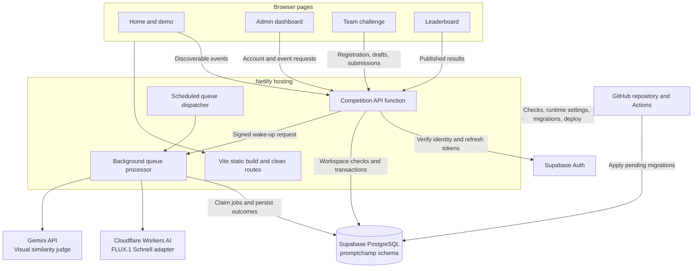
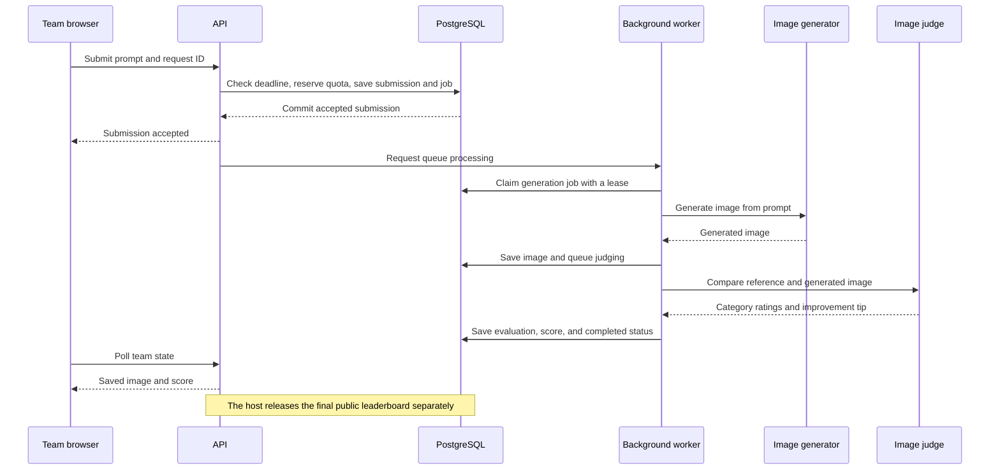
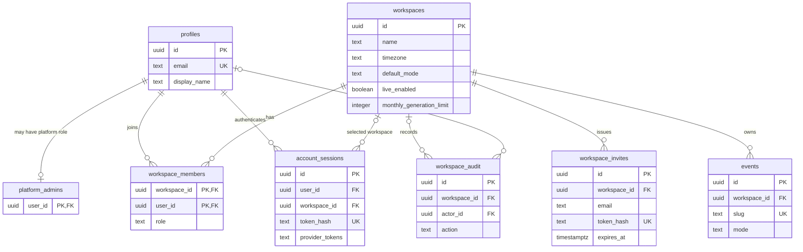
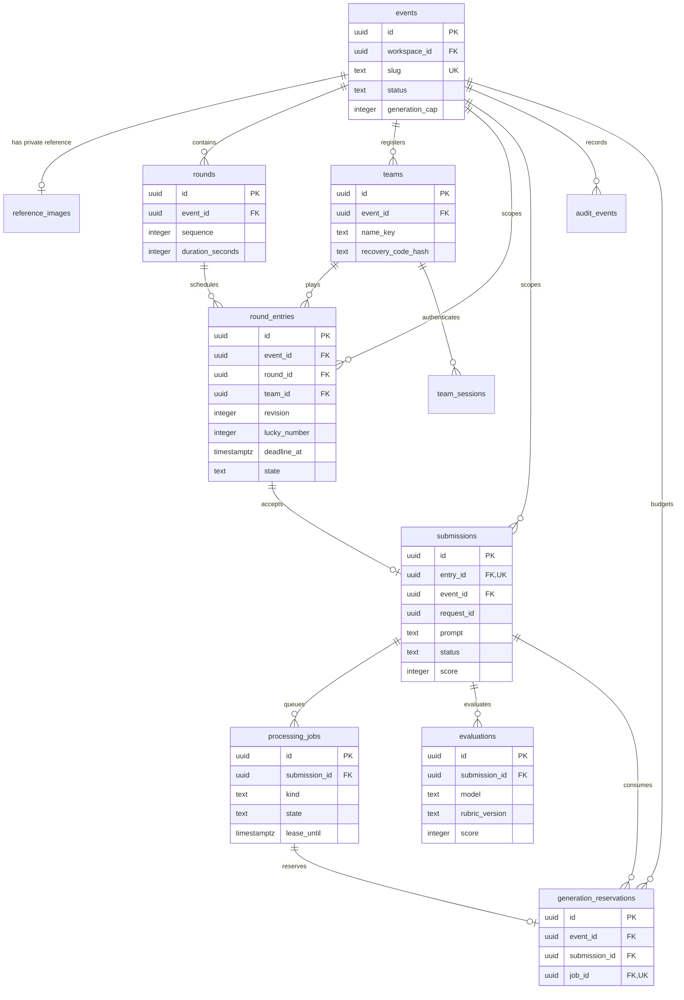

# PromptChamp

PromptChamp is a team image-prompt challenge platform. A host prepares a reference image, teams write prompts to recreate it, and AI evaluates how closely their generated images match the reference.

**Live application:** [promptchamp.mmizanurrahman.com](https://promptchamp.mmizanurrahman.com) · **Administration:** [Host dashboard](https://promptchamp.mmizanurrahman.com/admin)

## 1. Background and idea

The idea grew out of the monthly **IT Connect** office event, where teams take turns hosting quizzes, tasks, and question-answering activities. PromptChamp adds a creative challenge: how well can a team describe an image to an AI image generator?

The hosting team creates an event and preloads a reference image. Participating teams enter their team names and choose lucky numbers, which determine their playing order. Everyone receives the same reference image. When the host calls a team, that team presses **Start**, revealing the reference and starting its own host-configured **2- or 3-minute timer**. Teams submit a prompt before the deadline, then compare their recreation and visual-match score.

The platform has since expanded to support separate customer workspaces, verified administrator accounts, host invitations, demo/live events, and workspace usage limits. This provides a foundation for a future subscription service. **Payments and subscription billing are not implemented yet.**

### Current capabilities

- Verified email/password registration, login, email verification, and password recovery through Supabase Auth.
- Separate workspaces with owner and host roles, plus a platform administrator role.
- Event setup, private reference images, team registration, lucky-number draws, and host-controlled queues.
- Server-enforced turn deadlines, automatic draft saving, and team recovery codes.
- Demo events with sample images and simulated scores; live events with real image generation and judging.
- Durable background processing, event generation caps, and workspace monthly allowances.
- Held results, published leaderboards, scoring recovery, and CSV export.
- Automated checks, environment synchronization, database migrations, and production deployment through GitHub Actions.

## 2. Application architecture

PromptChamp is a **multi-page application**, built with Vite, TypeScript, HTML, and CSS. Each main page has its own HTML entry point and interactive TypeScript. Clean routes serve those pages without displaying `.html`; this is not a single-page application.



### Main components

| Component | Responsibility | Source |
| --- | --- | --- |
| Browser pages | Dashboard, team challenge, leaderboard, and demo | Root HTML/TypeScript/CSS files |
| API entry point | Dispatch account, host, team, and legacy competition requests | `netlify/functions/competition.ts` |
| Accounts and workspaces | Provider authentication, encrypted sessions, memberships, invitations, and platform controls | `server/account-api.ts`, `server/account-session.ts` |
| Event and team services | Event lifecycle, private references, registration, timers, drafts, and results | `server/event-api.ts`, `server/team-api.ts`, `server/results-api.ts` |
| Durable worker | Transactional job claims, leases, generation reservations, and processing recovery | `server/processing.ts` |
| AI adapters | Generate an image and compare it against the reference | `server/image-generation.ts`, `server/image-judging.ts` |
| Hosted workers | Background processing and scheduled queue dispatch | `netlify/functions/process-queue-background.ts`, `netlify/functions/queue-dispatch.ts` |
| Database migrations | Ordered, checksummed schema changes | `db/migrations/`, `scripts/migrate.mjs` |
| CI/CD | Build, isolated integration tests, configuration sync, migrations, and deployment | `.github/workflows/pipeline.yml` |

### Live submission flow



Generation and judging happen after prompt acceptance, so AI processing does not consume the team's writing time. A scheduled dispatcher provides a fallback if an immediate worker invocation is lost. Locally, the development server starts a processing loop instead of hosted background functions.

Demo submissions bypass provider calls and the live processing queue. Their sample images and deterministic scores are clearly labeled as simulated.

### Security and isolation

The browser calls the application API; it does not connect directly to private competition tables or receive database/AI credentials. Supabase Auth manages account credentials. The API verifies provider identity and workspace membership on account requests. Provider tokens are encrypted at rest, while browser account cookies hold opaque session identifiers.

Workspace checks isolate customer data. RLS is enabled on application tables, with supporting read policies for selected workspace tables; the current privileged backend also explicitly enforces authorization. RLS alone is not a substitute for those backend checks. Team sessions and private recovery codes are separate from administrator accounts.

## 3. Database design and relationships

The active workspace/event system uses the **`promptchamp` PostgreSQL schema**. Select that schema in Supabase when inspecting its tables. Supabase Auth manages its own identity data; `promptchamp.profiles.id` mirrors the provider user UUID without a declared foreign key to `auth.users`.

### Accounts and workspaces



`workspace_members` is the many-to-many link between users and workspaces. Its composite primary key prevents duplicate membership; `role` is `owner` or `host`. Platform privileges live separately in `platform_admins` and cannot be selected during registration.

### Events, gameplay, and AI processing



The diagrams show the main relationships and selected columns, not every field. `PK` means primary key, `FK` means foreign key, and `UK` means unique key. Optional relationships use a circle; crow's feet indicate many rows.

| Table or group | Purpose and important rules |
| --- | --- |
| `events` | Workspace-owned event, unique slug, schedule, team capacity, demo/live mode, generation cap, and result visibility |
| `reference_images` | At most one private reference per event; PNG/JPEG/WebP uploads are limited to 2 MiB |
| `rounds` | Event rounds with 120- or 180-second duration. The current event flow operates round sequence 1 |
| `teams`, `team_sessions` | Unique normalized team name per event, hashed recovery code, and expiring hashed session tokens |
| `round_entries` | Team turn, lucky number, queue position, persisted start/deadline, draft, and revision. Partial unique indexes prevent conflicting current turns and lucky numbers |
| `submissions` | One accepted submission per entry; `(event_id, request_id)` makes submission requests idempotent. Composite foreign keys keep entries and submissions in the same event |
| `processing_jobs` | Generate/judge work with leases; only one queued/running job per submission and job kind |
| `generation_reservations` | Records quota consumption, including failed or uncertain generation calls; each reservation belongs to one unique job |
| `evaluations` | Judging history including model, rubric version, category ratings, score, and tip |
| `audit_events`, `workspace_audit` | Event operations and workspace/account administration history |
| `worker_heartbeats` | Processing-worker readiness signals; no event foreign key |
| `platform_settings` | Singleton platform settings, including retirement of legacy shared-key login |
| `schema_migrations` | Applied migration filenames, checksums, and timestamps; created by the migration runner |

Reference and generated-image data are currently stored privately in PostgreSQL. Generated images expire after 30 days; prompts and scores remain. Moving image bytes to private object storage is a future scaling improvement.

The original competition backend also has separate `public.players` and `public.attempts` tables defined in `db/schema.sql`. Those are legacy tables, not the workspace event model. The new migration runner preserves them and does not require them for the modern team-event flow.

## 4. Install, clone, and run locally

### Prerequisites

- Git and **Node.js 22.13 or later**, with npm.
- A Supabase project with PostgreSQL and email/password authentication for account-based administration. Use a development project/database for local rehearsals.
- A database connection string accepted by the application's TLS configuration; see `server/database-tls.mjs` and the bundled public CA in `db/root-ca.pem`.
- For **live** events only: image-generation credentials and a Gemini judging API key. Demo events do not call either AI provider.

### Clone and install on Windows

Open PowerShell. For a fresh checkout:

```powershell
Set-Location D:\Projects
git clone https://github.com/mmrmilon/promptchamp.git PromptMatchCup
Set-Location .\PromptMatchCup
npm.cmd ci
Copy-Item .env.example .env
```

If this folder is already cloned, skip `git clone` and use `Set-Location D:\Projects\PromptMatchCup`. Do not overwrite an existing configured `.env`. Open **this project folder**, rather than its parent directory, in your editor to avoid mixing unrelated repositories in Source Control.

On macOS/Linux, use `git clone https://github.com/mmrmilon/promptchamp.git`, `cd promptchamp`, `npm ci`, and `cp .env.example .env`. The remaining npm commands are the same without the `.cmd` suffix.

### Configure `.env`

Uncomment or add the following entries with your own development values:

```dotenv
APP_MODE=demo
DATABASE_URL=postgresql://YOUR_DATABASE_CONNECTION_STRING
SESSION_SECRET=REPLACE_WITH_A_RANDOM_SECRET_AT_LEAST_32_CHARACTERS
SUPABASE_URL=https://YOUR_PROJECT.supabase.co
SUPABASE_PUBLISHABLE_KEY=YOUR_PUBLISHABLE_KEY
PLATFORM_OWNER_EMAIL=your-admin-email@example.com
PUBLIC_APP_URL=http://localhost:5173

# Required only when using real AI in live events:
CLOUDFLARE_ACCOUNT_ID=YOUR_ACCOUNT_ID
CLOUDFLARE_API_TOKEN=YOUR_IMAGE_API_TOKEN
GEMINI_JUDGE_API_KEY=YOUR_JUDGE_API_KEY
```

Generate a session secret locally, then copy its output into `.env`:

```powershell
node -e "console.log(require('node:crypto').randomBytes(32).toString('hex'))"
```

Keep `.env` out of Git. Use the **publishable** Supabase key, not a service-role/secret key. `PLATFORM_OWNER_EMAIL` is a trusted bootstrap setting: a verified account matching it receives the initial platform role. Use an address you control.

`APP_MODE` controls the original competition experience; modern events choose their own demo/live mode in the database. Global `EVENT_START`, `EVENT_END`, and `GENERATION_CAP` are not needed for the modern team-event setup. `ADMIN_ACCESS_KEY` is optional transition access for the original office workspace, not the normal registered-account login.

### Configure local authentication redirects

In your development Supabase project's **Authentication → URL Configuration**, set the local Site URL to `http://localhost:5173/admin` and allow:

```text
http://localhost:5173/admin
http://localhost:5173/admin?recovery=1
```

Enable email/password authentication and email confirmation. Configure mail delivery for verification and password reset; production registration needs suitable SMTP configuration. Login addresses may be Gmail or office email addresses, independently of the SMTP sender. For a shared production project, retain its production Site URL and add local redirects instead of replacing it. See [account setup](docs/accounts.md).

### Apply migrations and start

```powershell
npm.cmd run migrate
npm.cmd run dev -- --port 5173 --strictPort
```

The migration runner creates the `promptchamp` schema and applies pending numbered migrations under a lock. It records checksums and rejects edits to already-applied migrations; add a new migration for later schema changes.

Open [http://localhost:5173](http://localhost:5173). The dev server serves both pages and API requests. It also starts the local AI processing loop when credentials are configured. Stop it with **Ctrl+C**. `npm.cmd run worker` can run a separate local processing worker if needed.

| Route | Use |
| --- | --- |
| `/` | Discoverable office events |
| `/admin` | Registration, login, workspace dashboard, and event controls |
| `/event?event=your-event-slug` | Team registration, lucky number, and timed challenge |
| `/leaderboard?event=your-event-slug` | Published leaderboard |
| `/share?event=your-event-slug` | Large-screen registration QR code with full-screen controls |
| `/demo` | Original offline demonstration |

Old `.html` routes redirect to their clean equivalents while retaining query parameters.

### Useful commands

| Command | Purpose |
| --- | --- |
| `npm.cmd ci` | Install the locked dependency versions |
| `npm.cmd run dev` | Start local pages, API, and processing loop |
| `npm.cmd run migrate` | Apply pending migrations to `DATABASE_URL` |
| `npm.cmd run build` | Produce the static frontend in `dist/` |
| `npm.cmd run check` | Build pages and compile all functions |
| `node --test scripts/test-runtime-env.mjs` | Test configuration synchronization using mocked HTTP |
| `npm.cmd run test:ci` | Run the isolated database-backed integration harness |

The full CI harness requires a disposable loopback PostgreSQL database named `promptchamp_ci`, test environment settings, and a checkout **without `.env`**. Prefer GitHub Actions for that suite; do not point it at your office database. A frontend-only Vite preview does not start the application's API or worker.

## 5. How to use PromptChamp

### Register and prepare a workspace

1. Open `/admin`, choose **Register**, and enter your name, email, and password.
2. Confirm the email, then sign in. Passwords must contain at least 12 characters.
3. The verified bootstrap owner receives platform administration and ownership of the reserved **IT Connect Office** workspace. Other users can create their own demo workspaces through onboarding.
4. In **Settings**, configure the workspace name, timezone, default mode, and default turn duration.
5. In **Members**, an owner can create a host invitation link. Share it privately; the invited person must sign in with the matching verified email. Invitations expire after seven days and are not emailed automatically.

| Role | Responsibilities |
| --- | --- |
| Platform admin | Approve live AI access, set monthly workspace allowances, and suspend/reactivate workspaces |
| Workspace owner | Manage workspace settings and hosts, create events, and operate challenges |
| Event host | Create and run events in an invited workspace; cannot manage memberships or platform access |
| Participating team | Join by event link and play with its own team session/recovery code; no administrator account required |

New customer workspaces start with demo access. A platform administrator must enable live access before their events can use AI. Workspaces keep separate events, teams, references, and results. Customer events are unlisted by default, so share their event links directly.

### Host an event

1. In **Events**, create a draft with a title, unique slug, schedule, team capacity, **2- or 3-minute timer**, and demo/live mode.
2. Upload a PNG, JPEG, or WebP reference under 2 MiB, or reuse a reference from the workspace library. Every team receives this same image.
3. Review the generation safety cap under advanced settings. It bounds real AI requests in addition to the workspace's monthly allowance.
4. Open registration. The team queue shows the `/event?event=...` link and a QR code for that exact address. Choose **Show on big screen** to open the presentation view, then **Full screen** (or F11) on your projector. Each team scans with its phone camera and joins through the existing registration flow. You can also copy the link or download the QR as an SVG. The presentation checks registration status every 15 seconds and hides the registration QR when the draw is locked. QR images are generated locally in the browser; no third-party QR service receives the event link.
5. After teams join and choose available lucky numbers, close registration and lock the draw. Lower lucky numbers play first.
6. Call the next team. Only the called team can press **Start**. A team can be skipped and recalled before it starts.
7. Monitor accepted submissions and processing. For judging failures, retry using the saved image. Uncertain generation calls require a deliberate host decision; generating again consumes another quota reservation.
8. Once turns and outstanding results are resolved, publish the final leaderboard and share its clean link. Export results as CSV if needed.

Event settings and the reference freeze once teams register. Use a separate rehearsal event for testing. Keep the active team's screen away from waiting teams so the shared reference is not revealed early.

### Participate as a team

1. Open the host's event link, enter a team name, and **save the private recovery code**.
2. Choose an available lucky number and wait for the host to call your team.
3. Press **Start** when ready. This reveals the reference and starts your own server-tracked deadline.
4. Write and refine a prompt. Drafts save automatically, but you must press **Submit** before time expires. A prompt must contain 5–1,000 characters.
5. Submission is final. In live mode, the image is generated and scored after acceptance. You may return later using the team session or recovery code.
6. View your saved result and, after the host releases it, the final leaderboard.

Refreshing or recovering on another device does not restart the timer. Expired drafts are not submitted automatically. The lucky number chooses order, not a different image.

### Understand the score and AI budget

The live judge compares the reference and generated image using five categories:

| Category | Weight |
| --- | --- |
| Main subject | 30% |
| Setting and objects | 25% |
| Composition | 20% |
| Lighting and color | 15% |
| Visual style | 10% |

Each category receives a rating from 0 to 5, which the server converts into a weighted score out of 100. The result is an AI assessment, not exact pixel similarity. Equal scores share a rank.

Live generations consume both the event cap and the workspace's UTC-calendar-month allowance. Failed or uncertain calls retain their reservations; judging retries reuse the saved image. Demo events use no live AI allowance. Provider quotas and billing remain separate from these application limits.

## 6. Production deployment and further documentation

GitHub is the production configuration source. Maintain secrets and variables in **Repository Settings → Environments → production**, then run CI/CD to apply changes. The workflow maps `PRODUCTION_DATABASE_URL` to runtime `DATABASE_URL`, synchronizes approved runtime settings, applies pending migrations, and deploys to Netlify after checks pass. Local `.env` values are not uploaded automatically.

Pull requests run build and isolated integration checks. Merge passing changes to `main` for production deployment. Keep independent hosting builds stopped so they do not bypass this workflow. See the CI/CD guide for the complete required secret list and the approved standard-variable fallback on plans without granular environment scopes.

For the live domain, Supabase must allow both `https://promptchamp.mmizanurrahman.com/admin` and `https://promptchamp.mmizanurrahman.com/admin?recovery=1`. Retain legacy HTML callback entries while previously issued emails are still valid. Set GitHub's `PUBLIC_APP_URL` variable to the production origin so new emails use the intended domain.

- [Accounts and workspaces](docs/accounts.md): authentication, roles, bootstrap ownership, SMTP, redirects, and shared-key retirement.
- [CI/CD](docs/ci-cd.md): required GitHub settings, runtime synchronization, checks, migrations, and deployment.
- [Deployment](docs/deployment.md): hosting, workers, image storage, and live rehearsal checks.
- [Event design](docs/office-event-design.md): original requirements and architectural direction; some items describe future work.

Future improvements include subscription billing, private object storage, and corporate sign-in. Personal host accounts and workspace ownership are already implemented.
